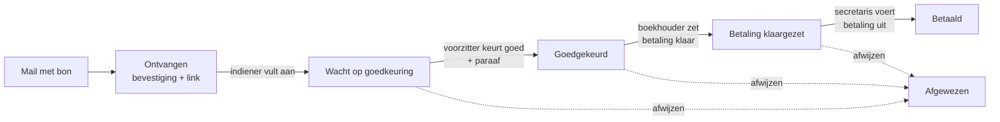

# Beheerdocument

Dit document beschrijft wat er gebouwd is, hoe het werkt en hoe je een installatie beheert. Het is
bedoeld als naslag voor de beheerder en een eventuele opvolger: alles wat nodig is om de tool te
begrijpen, bij te werken en terug te zetten.

Dit document staat in een openbare repository en is daarom algemeen gehouden: er staan geen
wachtwoorden, sleutels, IP-adressen of accountgegevens in. Leg de gegevens van je eigen installatie
vast op een plek die niet openbaar is, bijvoorbeeld een privé-repository of je wachtwoordmanager.
In [hoofdstuk 4](#4-je-eigen-installatie-vastleggen) staat wat je daarin opneemt.

Laatst bijgewerkt: 18 oktober 2026.

## Inhoud

1. [In het kort](#1-in-het-kort)
2. [Wat de tool doet](#2-wat-de-tool-doet)
3. [Overzicht van de onderdelen](#3-overzicht-van-de-onderdelen)
4. [Je eigen installatie vastleggen](#4-je-eigen-installatie-vastleggen)
5. [Inloggen op de server](#5-inloggen-op-de-server)
6. [Dagelijks beheer](#6-dagelijks-beheer)
7. [Bijwerken](#7-bijwerken)
8. [Configuratie en geheimen](#8-configuratie-en-geheimen)
9. [Mail](#9-mail)
10. [Back-up en herstel](#10-back-up-en-herstel)
11. [Beveiliging](#11-beveiliging)
12. [App op de telefoon (PWA)](#12-app-op-de-telefoon-pwa)
13. [Problemen oplossen](#13-problemen-oplossen)
14. [Noodscenario's](#14-noodscenarios)
15. [De code aanpassen](#15-de-code-aanpassen)
16. [Geschiedenis: wat er gebouwd is](#16-geschiedenis-wat-er-gebouwd-is)
17. [Bewuste keuzes en afgewezen ideeën](#17-bewuste-keuzes-en-afgewezen-ideeën)

---

## 1. In het kort

| Wat | Waar |
| --- | --- |
| Website | `https://<jouw-domein>` |
| Declaratie-mailadres | de mailbox van de tool, bijvoorbeeld `declaraties@<jouw-domein>` |
| Broncode en documentatie | https://github.com/jip67/declaratietool (branch `main`) |
| Docker-image (door GitHub gebouwd) | `ghcr.io/jip67/declaratietool` |
| Server | een kleine VPS met Debian of Ubuntu |
| Map op de server | `/opt/declaratietool` |
| Domein en DNS | bij je registrar; A-record naar de server |
| Mailbox | elke mailbox met IMAP en SMTP |
| Back-up | elke nacht 03:30, versleuteld naar Google Drive, map `declaratietool-backup` |
| Inloggen op de server | alleen met SSH-sleutel (bijvoorbeeld PuTTY met een `.ppk`-bestand) |
| Noodtoegang server | de console in het klantpaneel van je VPS-aanbieder |

De drie dingen die je **buiten de server** moet bewaren, bijvoorbeeld in een wachtwoordmanager:

1. de **back-upsleutel** (zonder die sleutel is geen enkele back-up terug te zetten);
2. je **SSH-sleutel** met de passphrase, en het root-wachtwoord van de server;
3. de inloggegevens van de **VPS-aanbieder**, de **registrar en mailbox**, **GitHub** en het
   **Google-account** van de back-up.

---

## 2. Wat de tool doet

Een webapplicatie om declaraties van de vereniging af te handelen, van een gemailde foto van een
bon tot en met de betaling.

### De workflow



1. **Indienen.** Iemand mailt een foto of pdf van de bon naar het declaratie-adres. De tool
   haalt elke minuut nieuwe (ongelezen) mail op, maakt een declaratie met een kenmerk als
   `D2026-0001` en stuurt een bevestiging met een persoonlijke link. Meerdere bonnen in één mail
   worden één declaratie. Mail zonder bijlage krijgt een nette weigering; afwezigheidsmeldingen
   worden genegeerd.
2. **Aanvullen.** Via de link vult de indiener bedrag, omschrijving, IBAN en tenaamstelling in.
   Rekeninggegevens worden per e-mailadres onthouden en de volgende keer vooraf ingevuld (en zijn
   aan te passen).
3. **Goedkeuren.** De voorzitter krijgt een mail, keurt goed in het portaal, en elke bon krijgt
   automatisch een paraaf: een stempel met GOEDGEKEURD, naam, datum en kenmerk, opgeslagen als pdf.
4. **Betaling klaarzetten.** De boekhouder krijgt een mail met alle gegevens en de
   geparafeerde bonnen en zet de betaling klaar bij de bank.
5. **Betaling uitvoeren.** De secretaris krijgt bericht en voert de betaling uit bij de bank.
6. Bij elke stap krijgt de indiener een update. Wie een taak open heeft, krijgt elke ochtend
   (vanaf 9:00) één herinnering met al zijn taken.

Afwijzen kan in elke stap, met een reden die de indiener ziet. De laatste stap is ongedaan te
maken door wie hem zette, of door een beheerder.

### Rollen

| Rol (in de code) | Naam in de tool | Mag |
| --- | --- | --- |
| `chair` | Voorzitter | goedkeuren en paraferen |
| `treasurer` | Boekhouder | betaling klaarzetten |
| `secretary` | Secretaris | betaling uitvoeren |
| `admin` | Beheerder | gebruikers, mailinstellingen, updates, declaraties bewerken en wissen, meekijken |
| `member` | Gebruiker | eigen declaraties indienen en alleen die zien |

Iemand kan meerdere rollen hebben, bijvoorbeeld `admin` en `treasurer`. De rol Beheerder geeft
**geen** rechten in de workflowstappen: goedkeuren kan alleen de voorzitter, enzovoort. Bezoekers
zonder account zien alleen het inlogscherm; indieners zonder account gebruiken de mail en hun
persoonlijke link (`/c/<code>`).

### Functies in het portaal

- Overzicht met filters en **Mijn taken**; detailpagina per declaratie met bijlagen (foto's direct
  zichtbaar, pdf's in een viewer), geschiedenis en **interne opmerkingen** (nooit zichtbaar voor de
  indiener).
- **Nieuwe declaratie** namens iemand (voor wie geen mail gebruikt of een papieren bon inlevert).
- **Eenvoudige weergave** voor bestuursleden die weinig met computers doen: alleen de eigen taken
  als grote kaarten.
- **Instellingen** (zijbalk):
  - **Gebruikers**: toevoegen, bewerken, uitzetten, verwijderen, 2FA resetten, **Meekijken**
    (alleen-lezen het portaal zien zoals iemand anders het ziet);
  - **Logboek**: inlogs, mislukte inlogpogingen en binnengekomen mail (90 dagen bewaard);
  - **Mailinstellingen** (beheerder): SMTP/IMAP, met testknoppen;
  - **Meldingen**: per persoon kiezen welke e-mailmeldingen je krijgt;
  - **Updates** (beheerder): versie, nieuwe versie installeren, status van de back-up.
- **Help**: uitleg in de tool zelf, NL en EN.
- **Tweestapsverificatie** per gebruiker (app of code per mail).
- Te installeren als **app op de telefoon**, met een teller van openstaande taken op het icoon.
- Nederlands en Engels.

Uitgebreide uitleg per rol: [gebruik.md](gebruik.md).

---

## 3. Overzicht van de onderdelen

### Techniek

Python 3.13, FastAPI, SQLAlchemy met Alembic (databasemigraties), PostgreSQL 17, Jinja2-templates,
Caddy als webserver met automatisch https (Let's Encrypt). Geen JavaScript-framework.

### Containers (docker-compose)

| Dienst | Doet | Bereikbaar |
| --- | --- | --- |
| `caddy` | https, certificaat, stuurt door naar `app` | poort 80 en 443, publiek |
| `app` | de website en het portaal; werkt bij het starten de database bij | alleen `127.0.0.1:8000` |
| `worker` | haalt elke minuut mail op, verstuurt de dagelijkse herinneringen, ruimt het logboek op | niet |
| `db` | PostgreSQL | alleen intern |

Gegevens staan in Docker-volumes: `pgdata` (database), `uploads` (bonnen en geparafeerde pdf's),
`caddy_data` en `caddy_config` (certificaat). Op de server heten ze `declaratietool_pgdata` enz.

### Op de server, buiten Docker

| Onderdeel | Doet |
| --- | --- |
| `declaratietool-updater.path` + `.service` | voert een update uit zodra de knop in het portaal is ingedrukt |
| `declaratietool-updater.timer` | kijkt elk uur of er een nieuwe versie op GitHub staat |
| `declaratietool-backup.timer` + `.service` | maakt elke nacht om 03:30 de back-up |
| `ufw` | firewall: alleen 22, 80 en 443 open |
| `fail2ban` | blokkeert IP-adressen die SSH-wachtwoorden raden |
| `unattended-upgrades` | automatische beveiligingsupdates van Debian |

### De repository

| Pad | Inhoud |
| --- | --- |
| `app/` | de applicatie. Belangrijkste bestanden: `workflow.py` (stappen en mails), `intake.py` (mail ophalen), `reminders.py`, `stamping.py` (paraaf), `models.py` (datamodel), `routes/` (pagina's), `templates/`, `locales/nl.json` en `en.json` (teksten) |
| `migrations/versions/` | databasewijzigingen, genummerd `0001` t/m `0006` |
| `deploy/install-vps.sh` | installeert alles op een verse server |
| `deploy/updater.sh` | voert een controle of update uit |
| `deploy/backup.sh` | back-up maken, instellen, tonen en terugzetten |
| `deploy/systemd/` | de systemd-units van updater en back-up |
| `docker-compose.yml`, `Dockerfile`, `Caddyfile` | containers en webserver |
| `.env.example` | voorbeeld van de instellingen |
| `tests/` | automatische tests (pytest) |
| `.github/workflows/ci.yml` | GitHub Actions: tests en Docker-image |
| `.github/dependabot.yml` | wekelijkse voorstellen voor pakket-updates |
| `docs/` | documentatie, waaronder dit bestand |

---

## 4. Je eigen installatie vastleggen

Leg de gegevens van je eigen installatie vast op een plek die **niet openbaar** is. Neem daarin op:

| Onderwerp | Wat je noteert |
| --- | --- |
| Server | aanbieder, pakket, besturingssysteem, IP-adres, naam van de server in het klantpaneel |
| Firewall bij de aanbieder | of er een beleid is dat uitgaande mail blokkeert, en wat je daaraan veranderd hebt |
| Domein | registrar, nameservers, welke A-records naar de server wijzen, wanneer het verlengd moet worden |
| Mailbox | adres, aanbieder, IMAP- en SMTP-server met poort en SSL/STARTTLS |
| SSH | gebruikersnaam, waar de sleutel staat, naam van het instellingenbestand voor sleutel-alleen |
| Accounts | welk account waarvoor is (server, domein, mail, GitHub, Google-back-up) en wie er toegang toe heeft |
| Beheerders | wie de rol Beheerder heeft in de tool |

Een paar dingen die bij elke installatie gelden:

- **Installatie:** met `deploy/install-vps.sh` (zie [ovh-vps.md](ovh-vps.md)); het script werkt op
  Debian en Ubuntu bij elke aanbieder.
- **Uitgaande mail:** sommige VPS-aanbieders blokkeren standaard uitgaande mailpoorten (465/587)
  met een firewallbeleid in hun klantpaneel. Bij Netcup heet dat bijvoorbeeld *netcup Mail block*.
  Haal dat weg of vraag de aanbieder het vrij te geven, anders kan de tool geen mail versturen.
- **Domein:** Caddy haalt het https-certificaat zelf op en vernieuwt het automatisch. Daarvoor moet
  het A-record naar de server wijzen en poort 80 en 443 open staan. Vergeet het domein niet op tijd
  te verlengen.
- **Mailbox:** gebruik hem alleen voor de tool: elke ongelezen mail wordt als declaratie verwerkt.
  Lees hem dus niet met een mailprogramma dat mail als gelezen markeert, of markeer hem daarna weer
  als ongelezen. Proton Mail werkt niet, omdat Proton geen gewone IMAP-toegang heeft.

---

## 5. Inloggen op de server

### Normaal: PuTTY met SSH-sleutel

Log op de server **alleen met een sleutel** in, niet met een wachtwoord.

- Maak de sleutel met **PuTTYgen**, type Ed25519, met een passphrase, en sla hem op als
  `.ppk`-bestand. Bewaar een reservekopie (USB-stick of wachtwoordmanager).
- Maak in PuTTY een opgeslagen sessie: host `<jouw-domein>`, poort 22,
  *Connection → Data → Auto-login username* `root`, en bij *Connection → SSH → Auth → Credentials*
  het `.ppk`-bestand. Kies de sessie, **Load**, **Open**, en typ de passphrase.
- De publieke sleutel (`ssh-ed25519 AAAA...`) komt op de server in `/root/.ssh/authorized_keys`.
  Veel aanbieders laten je hem ook in hun klantpaneel opslaan; dan zetten ze hem automatisch op
  de server bij een herinstallatie.
- Wachtwoordlogin staat uit via `/etc/ssh/sshd_config.d/00-alleen-sleutels.conf`:

  ```
  PasswordAuthentication no
  KbdInteractiveAuthentication no
  PermitRootLogin prohibit-password
  ```

  De `00` zorgt dat dit bestand voorgaat op instellingen die de aanbieder al heeft neergezet. Controleren:
  `sshd -T | grep -E 'passwordauthentication|kbdinteractive|permitrootlogin'` geeft `no`, `no` en
  `without-password` (de oude naam voor `prohibit-password`).

### Een nieuwe computer of een tweede sleutel

1. Maak op de nieuwe computer een sleutel met PuTTYgen (of `ssh-keygen -t ed25519`).
2. Log in vanaf een computer die al werkt (of via de console van de aanbieder) en zet de publieke sleutel
   als extra regel in `/root/.ssh/authorized_keys`.
3. Test in een nieuw venster voordat je iets anders verandert.

Een sleutel intrekken: haal de regel weg uit `authorized_keys`.

### Noodtoegang: de console van de aanbieder

Sleutel kwijt of computer kapot? Log in op het klantpaneel van je VPS-aanbieder (bij Netcup
bijvoorbeeld het Server Control Panel), open je server en kies de **console** (scherm). Daar log je in als `root` met het **root-wachtwoord**; de sleutelregel geldt
alleen voor SSH, niet voor de console. Zet daarna een nieuwe sleutel in `authorized_keys`, of zet
tijdelijk wachtwoordlogin terug door het bestand te verwijderen:

```sh
rm /etc/ssh/sshd_config.d/00-alleen-sleutels.conf
systemctl reload ssh
```

Weet je het root-wachtwoord ook niet meer, dan kun je het meestal in het klantpaneel opnieuw laten instellen.

---

## 6. Dagelijks beheer

De tool draait vanzelf. Wat je als beheerder af en toe doet:

| Taak | Hoe |
| --- | --- |
| Nieuwe bestuurder | **Instellingen → Gebruikers → toevoegen** met de juiste rol; het oude account uitzetten (geschiedenis blijft kloppen) |
| Iemand kan niet inloggen | **Gebruikers → Bewerken**: nieuw wachtwoord, of 2FA resetten. In het **Logboek** zie je waarom een poging mislukte (bij 5 foute pogingen 15 minuten blokkade) |
| Iemand helpen met de tool | **Gebruikers → Meekijken**: je ziet precies wat die persoon ziet, zonder iets te kunnen wijzigen |
| Fout in een declaratie | **Declaratie bewerken** (beheerder), of **Laatste stap ongedaan maken** |
| Testdeclaraties opruimen | **Declaratie wissen** onderaan de declaratie (definitief) |
| Kijken of alles goed gaat | **Instellingen → Updates**: versie en laatste back-up. Het overzicht waarschuwt als de back-up mislukt of ouder dan 36 uur is |
| Meldingen | **Instellingen → Meldingen**: mail bij nieuwe declaratie, statuswijziging, taak die te lang openstaat; voor beheerders ook bij logins, blokkades en binnenkomende mail |

Op de server (in `/opt/declaratietool`):

```sh
docker compose ps                              # draaien alle vier de diensten?
docker compose logs -f app worker caddy        # logboek (Ctrl+C om te stoppen)
docker compose restart app worker              # herstarten
docker compose exec app python -m app.cli send-reminders   # herinneringen nu versturen
docker compose exec app python -m app.cli create-user --email ... --name "..." --roles admin
```

Met `create-user` op een bestaand e-mailadres wijzig je dat account; zo kom je er ook weer in als
je je eigen wachtwoord kwijt bent.

---

## 7. Bijwerken

Nieuwe versies komen uit de branch `main` op GitHub.

**Via het portaal (normaal):** **Instellingen → Updates → Nu bijwerken.** Staat er een uitroepteken
bij Instellingen, dan is er een nieuwe versie. De tool haalt `main` op, bouwt opnieuw, werkt de
database bij en herstart; alleen tijdens het herstarten (enkele seconden) is hij niet bereikbaar.
Mislukt het, dan blijft de vorige versie draaien en staat het logboek op die pagina.

**Hoe dat werkt:** de app heeft bewust geen toegang tot Docker (wie Docker bestuurt, is baas over de
hele server). De knop schrijft alleen het woord `update` in `update/requests/request`; de
systemd-unit `declaratietool-updater.path` ziet dat en start `deploy/updater.sh` als root. Die
schrijft de status terug in `update/status/` (voor de app alleen-lezen). Details:
[bijwerken.md](bijwerken.md).

**Op de server:**

```sh
sudo /opt/declaratietool/deploy/updater.sh update
# of met de hand:
cd /opt/declaratietool && git pull && docker compose up -d --build
```

**Na een update waarin `deploy/systemd/` of `deploy/install-vps.sh` is veranderd:** draai het
installatiescript nog een keer (`.env` blijft staan): `sudo bash /opt/declaratietool/deploy/install-vps.sh`.

**Debian zelf** werkt automatisch beveiligingsupdates bij. Af en toe (bijvoorbeeld elk kwartaal)
handmatig: `apt update && apt upgrade`, en zo nodig `reboot`. Na een herstart komen de containers
vanzelf terug (`restart: unless-stopped`).

**GitHub Actions** draait bij elke wijziging de tests en bouwt de image `ghcr.io/jip67/declaratietool`.
Een server die met `install-vps.sh` is ingericht bouwt zelf en gebruikt die image niet; hij is er als alternatief (`IMAGE=` in `.env`,
zie [installatie.md](installatie.md#alternatief-kant-en-klaar-image)). **Dependabot** stelt pull
requests voor als er updates van pakketten zijn; samenvoegen op GitHub en daarna bijwerken.

---

## 8. Configuratie en geheimen

Alle serverinstellingen staan in **`/opt/declaratietool/.env`** (alleen leesbaar voor root). Een
volledige lijst met uitleg staat in [configuratie.md](configuratie.md). Na een wijziging:
`docker compose up -d`.

De belangrijkste:

| Instelling | Inhoud |
| --- | --- |
| `DOMAIN` / `BASE_URL` | `<jouw-domein>` / `https://<jouw-domein>` |
| `SECRET_KEY` | geheim, door het installatiescript gemaakt |
| `POSTGRES_PASSWORD` | geheim, door het installatiescript gemaakt |
| `IMAP_*`, `SMTP_*`, `MAIL_FROM` | de mailbox (zie [Mail](#9-mail)) |
| `REMINDER_HOUR` | standaard 9 |
| `LOG_RETENTION_DAYS` | standaard 90 |

Waar geheimen staan:

| Geheim | Waar | Kwijt? |
| --- | --- | --- |
| `SECRET_KEY` | `.env`, en in elke back-up | Nieuwe maken (`openssl rand -hex 32`); iedereen moet opnieuw inloggen en het mailwachtwoord moet opnieuw in Mailinstellingen |
| `POSTGRES_PASSWORD` | `.env`, en in elke back-up | Niet veranderen zolang de database bestaat |
| Mailwachtwoord | `.env` en/of versleuteld in de database (Mailinstellingen) | Opnieuw instellen bij de mailaanbieder en invullen in Mailinstellingen |
| Back-upsleutel | `/etc/declaratietool/backup.key` en **in je wachtwoordmanager** | Oude back-ups zijn dan niet meer te openen |
| Google Drive-koppeling | `/etc/declaratietool/rclone.conf` | `backup.sh setup` opnieuw draaien |
| Wachtwoorden van gebruikers | als scrypt-hash in de database | Beheerder stelt een nieuw wachtwoord in |

Zet `.env`, de back-upsleutel of wachtwoorden **nooit** in GitHub. `.env` staat daarom in `.gitignore`.

---

## 9. Mail

- **Binnenkomend:** de `worker` kijkt elke 60 seconden in de map INBOX van de mailbox, verwerkt
  elke **ongelezen** mail en markeert hem als gelezen. Foto's (jpg, png, heic, webp) en pdf's
  worden bijlagen; kleine plaatjes in handtekeningen worden overgeslagen. Alles staat in
  **Logboek → Binnengekomen mail**.
- **Uitgaand:** bevestigingen, taken, statusupdates, herinneringen en meldingen gaan via SMTP van
  dezelfde mailbox. Afzendernaam instelbaar (`MAIL_FROM_NAME`).
- **Instellen:** in het portaal onder **Instellingen → Mailinstellingen** (gaat vóór `.env`; met
  knoppen om SMTP en IMAP te testen). Het wachtwoord wordt versleuteld opgeslagen met een sleutel
  afgeleid van `SECRET_KEY`.
- **Poorten:** IMAP meestal 993 (SSL). SMTP 465 met `SMTP_SSL=true` en `SMTP_STARTTLS=false`,
  of 587 met `SMTP_STARTTLS=true` en `SMTP_SSL=false`.
- Een mail die niet verstuurd kan worden, gaat verloren (hij wordt niet later opnieuw geprobeerd);
  de fout staat in `docker compose logs worker`.

---

## 10. Back-up en herstel

Uitgebreid: [backup.md](backup.md). Samengevat:

- **Wat:** database, alle bijlagen en `.env`, samen in één bestand, op de server **versleuteld**
  met gpg (AES-256) met de back-upsleutel.
- **Wanneer:** elke nacht om 03:30 (`declaratietool-backup.timer`); een gemiste back-up wordt na
  het opstarten ingehaald.
- **Waar:** op de server in `/var/backups/declaratietool` en op Google Drive in de map
  `declaratietool-backup`. De server heeft alleen toegang tot de bestanden die hij zelf op de
  Drive zet.
- **Hoe lang:** 7 dagelijkse back-ups (server en Drive), plus op Drive de eerste back-up van elke
  maand voor de huidige en 3 vorige maanden. Aanpassen met `KEEP_DAYS`/`KEEP_MONTHS` via
  `sudo systemctl edit declaratietool-backup`.
- **Controleren:** **Instellingen → Updates** in het portaal, of op de server:

  ```sh
  sudo /opt/declaratietool/deploy/backup.sh list    # back-ups op Drive en op de server
  sudo /opt/declaratietool/deploy/backup.sh         # nu een back-up maken
  journalctl -u declaratietool-backup -n 50
  ```

- **Terugzetten op dezelfde server** (vervangt alle huidige gegevens):

  ```sh
  sudo /opt/declaratietool/deploy/backup.sh restore declaratietool-JJJJ-MM-DD_0330.tar.gz.gpg
  ```

- **Terugzetten op een nieuwe server:** zie [Noodscenario's](#server-kwijt-of-kapot).
- **Met de hand openen** op elke computer met gpg (Gpg4win op Windows):
  `gpg -d bestand.tar.gz.gpg > backup.tar.gz` en `tar xzf backup.tar.gz` (geeft `database.sql`,
  `uploads.tar.gz`, `env`, `versie.txt`).
- **Extra:** snapshots bij je VPS-aanbieder zijn handig vóór een grote wijziging, maar staan bij
  dezelfde partij. Probeer eens per jaar of terugzetten werkt.

---

## 11. Beveiliging

Uitgebreid: [beveiliging.md](beveiliging.md).

**In de tool:**

- https afgedwongen (HSTS); app en database niet direct van buitenaf bereikbaar.
- Wachtwoorden als scrypt-hash; na 5 foute pogingen per account of 20 per IP-adres 15 minuten
  blokkade.
- **Tweestapsverificatie** (optioneel per gebruiker): authenticator-app of code per mail, met 10
  herstelcodes. De beheerder kan 2FA resetten via **Gebruikers → Bewerken**.
- Ondertekende sessiecookie (12 uur geldig), bescherming tegen CSRF, Content-Security-Policy.
- Persoonlijke links met een willekeurige code van 32 tekens.
- Alleen pdf en foto's als bijlage, met een maximale grootte.
- De app draait niet als root en heeft geen toegang tot Docker.
- Logboek van alle inlogs en mislukte pogingen, 90 dagen bewaard.
- Anonieme bezoekers zien alleen het inlogscherm.

**Op de server:**

- SSH alleen met sleutel (zie [Inloggen op de server](#5-inloggen-op-de-server)).
- Firewall `ufw`: alleen 22, 80 en 443. Controleren: `ufw status`.
- `fail2ban` voor SSH: `fail2ban-client status sshd`.
- Automatische beveiligingsupdates (`unattended-upgrades`).

**Accounts:** zet 2FA aan op GitHub, de VPS-aanbieder, de registrar en het Google-account van de back-up. Wie bij
GitHub de code kan wijzigen, kan via de updateknop de server beïnvloeden.

---

## 12. App op de telefoon (PWA)

De tool is een Progressive Web App: via Chrome (Android: menu → **App installeren**) of Safari
(iPhone: deelknop → **Zet op beginscherm**) op het beginscherm te zetten. Er is geen app-winkel
nodig; een update op de server is meteen in de app te zien.

- `manifest` en iconen in `app/static`, service worker op `/sw.js`. Die bewaart alleen de
  offline-pagina, de opmaak en de iconen, **geen** declaraties of bankgegevens.
- **Teller op het icoon** (aantal eigen taken, via `/badge`): werkt op iPhone/iPad (iOS 16.4+, één
  keer aanzetten via **Mijn account**) en Windows/macOS. Op Android, en bijwerken terwijl de app
  dicht is, kan alleen met pushmeldingen; die zijn niet gebouwd.

---

## 13. Problemen oplossen

| Probleem | Kijk naar |
| --- | --- |
| Site niet bereikbaar | `docker compose ps`; `docker compose logs caddy`; wijst het A-record nog naar de server (`nslookup <jouw-domein>`)? Is het domein verlengd? |
| Certificaatfout | `docker compose logs caddy \| grep -iE "obtained\|error"`; poort 80/443 open? `docker compose restart caddy` |
| App start niet | `docker compose logs app --tail 50`. Vaak een fout in `.env`, bijvoorbeeld een lege `SMTP_PORT=` (moet een getal zijn) |
| Geen mail binnen | `docker compose logs worker`; **Logboek → Binnengekomen mail**; is de mail al gelezen (alleen ongelezen mail wordt verwerkt)? Test IMAP in Mailinstellingen |
| Geen mail verstuurd | Test SMTP in Mailinstellingen; `docker compose logs worker`. Uitgaande poorten vanaf de server testen: `nc -vz -w5 <smtp-server> 465`. Loopt dat vast, kijk dan of de firewall van de aanbieder uitgaande mail blokkeert |
| Mails in spam | SPF en DKIM voor je domein bij de mailaanbieder controleren |
| Update mislukt | Logboek op **Instellingen → Updates**, of `update/status/update.log`; `journalctl -u declaratietool-updater.service -n 50` |
| Back-up mislukt | `journalctl -u declaratietool-backup -n 50`; is de Google-koppeling verlopen, draai dan `backup.sh setup` opnieuw |
| Schijf vol | `df -h`; `docker system prune` ruimt oude images op (niet de volumes) |
| Herinneringen niet ontvangen | Ze gaan één keer per dag vanaf `REMINDER_HOUR`; wie een taak minder dan 12 uur heeft, wordt die dag nog niet herinnerd |

---

## 14. Noodscenario's

### Ik kom niet meer in de tool (eigen wachtwoord of 2FA kwijt)

Een andere beheerder reset het via **Gebruikers → Bewerken**. Is er geen andere beheerder, log dan
in op de server en stel een nieuw wachtwoord in:

```sh
cd /opt/declaratietool
docker compose exec app python -m app.cli create-user --email <jouw-adres> --name "<naam>" --roles admin,treasurer
```

Moet ook 2FA uit, laat dat dan daarna door een tweede beheerder doen, of gebruik een herstelcode.

### Ik kom niet meer op de server

Zie [Noodtoegang: de console van de aanbieder](#noodtoegang-de-console-van-de-aanbieder).

### Server kwijt of kapot

1. Bestel of herinstalleer een VPS met Debian (zo mogelijk met je SSH-sleutel uit het klantpaneel).
2. Haal een firewallbeleid weg dat uitgaande mail blokkeert (zie [hoofdstuk 4](#4-je-eigen-installatie-vastleggen)).
3. Heeft de nieuwe server een ander IP-adres, pas dan bij je registrar de A-records van `@` en `www` aan.
4. Log in als root en installeer:

   ```sh
   apt update && apt install -y curl
   curl -fsSL https://raw.githubusercontent.com/jip67/declaratietool/main/deploy/install-vps.sh -o install-vps.sh
   bash install-vps.sh
   ```

   Vul de domeinnaam in; het mailwachtwoord mag leeg blijven (komt uit de back-up).
5. Zet de back-upsleutel terug:

   ```sh
   mkdir -p /etc/declaratietool
   sh -c 'printf "%s" "JOUW-SLEUTEL" > /etc/declaratietool/backup.key && chmod 600 /etc/declaratietool/backup.key'
   ```

6. Koppel Google Drive opnieuw: `/opt/declaratietool/deploy/backup.sh setup` (op je eigen pc
   `rclone authorize "drive" "eyJzY29wZSI6ImRyaXZlLmZpbGUifQ"` draaien en de code plakken).
7. Zet de laatste back-up terug: `backup.sh list` en dan `backup.sh restore <bestand>`. Het script
   neemt `SECRET_KEY` over; de oude `.env` staat ter vergelijking in
   `/etc/declaratietool/env-uit-backup`. Neem daaruit zo nodig de mailinstellingen over in `.env`.
8. Zet SSH weer op sleutel-alleen (zie [hoofdstuk 5](#5-inloggen-op-de-server)).

### GitHub-account kwijt

De code staat ook op de server in `/opt/declaratietool` (een volledige git-kopie). Maak een nieuwe
repository, zet die code erin (`git remote set-url origin <nieuwe-url>` en `git push` in
`/opt/declaratietool`). De updateknop haalt altijd op van `origin`, dus daarna werkt hij met de
nieuwe repository.

### Iemand anders neemt het beheer over

Geef de opvolger: dit document, de rol Beheerder in de tool, een eigen SSH-sleutel op de server
(regel in `authorized_keys`), de back-upsleutel, en toegang tot of overdracht van de accounts bij
de VPS-aanbieder, de registrar, GitHub en Google. Haal daarna je eigen sleutel en accounts weg.

---

## 15. De code aanpassen

Zie [ontwikkeling.md](ontwikkeling.md) voor lokaal draaien en tests. In het kort:

- Werk in een branch, open een pull request op GitHub, laat de tests (GitHub Actions) groen worden
  en voeg samen in `main`. Daarna **Nu bijwerken** in het portaal.
- Commits gebruiken het GitHub-noreply-adres van `jip67` (de e-mailprivacy van GitHub weigert een
  ander adres).
- Teksten staan in `app/locales/nl.json` en `en.json`; een nieuwe taal is een kopie van `en.json`.
- Een databasewijziging is een nieuw bestand in `migrations/versions/` met het volgende nummer
  (nu `0007`, met `down_revision = "0006"`). Die wordt bij het starten van `app` automatisch
  uitgevoerd.
- Mailinstellingen altijd lezen via `app/mailconfig.load()`, niet direct uit `.env`.
- Nieuwe knoppen (POST) worden automatisch geblokkeerd tijdens Meekijken.
- Nieuwe meldingssoorten horen in `app/notifications.py` (`STAFF_KINDS`/`ADMIN_KINDS`) met
  teksten `notify.<soort>.*`.
- Interne opmerkingen mogen nooit op de pagina van de indiener, in mails of bij de rol Gebruiker
  verschijnen.

---

## 16. Geschiedenis: wat er gebouwd is

De tool is in oktober 2026 gebouwd, met hulp van Claude. Alle wijzigingen staan als pull requests
op GitHub; dit is het overzicht.

| Datum | Pull request(s) | Wat |
| --- | --- | --- |
| 7 okt | eerste versie | Basis: mail ophalen, formulier voor de indiener, workflow voorzitter → boekhouder → secretaris, paraaf, portaal, herinneringen, NL/EN, Docker, GitHub Actions |
| 8 okt | | Eerste installatie op een VPS met eigen domein en mailbox |
| 8 okt | #1 | Bijlage-preview, Nederlands als standaardtaal, helppagina |
| 9 okt | #2 | Beveiliging: alleen inlogscherm voor bezoekers, rol Gebruiker, CSRF, CSP, fail2ban, Dependabot |
| 9 okt | #8 | Knop **Bijwerken** in het portaal (updater via systemd) |
| 9 okt | #9 | Gebruikers bewerken en verwijderen |
| 9 okt | #10 | **Logboek**: inlogs, mislukte pogingen, binnengekomen mail |
| 9 okt | #11, #14 | **Mailinstellingen** in het portaal; afzendernaam instelbaar |
| 9 okt | #12 | Menu **Instellingen** |
| 9 okt | #13 | Mobiele lay-out: hamburgermenu, kaartjes, bijlagen als miniatuur |
| 9 okt | #15, #16 | Nieuwe vormgeving: frisse kleuren met menubalk aan de zijkant |
| 9 okt | #17 | Beheerder kan declaraties bewerken en wissen; **interne opmerkingen** |
| 10 okt | #18 | E-mailmeldingen voor de beheerder (logins, blokkades, binnenkomende mail) |
| 12 okt | #19 | **Tweestapsverificatie** met app of code per mail |
| 12 okt | #20 | Workflowstappen alleen voor de eigen rol; **laatste stap ongedaan maken** |
| 12 okt | | Helppagina: onderdeel Veiligheid en privacy |
| 12 okt | #21, #22, #23 | **Nachtelijke versleutelde back-up** naar Google Drive, met bewaarbeleid |
| 13 okt | #24 | **Meekijken** als andere gebruiker (alleen-lezen) |
| 13 okt | #25 | **Eenvoudige weergave** voor bestuursleden |
| 13 okt | #26 | Secretaris-stap heet *betaling uitvoeren* |
| 14 okt | #27 | **Meldingen** als persoonlijke instelling voor alle bestuursleden |
| 14 okt | #28 | Menu **Updates** met uitroepteken bij een nieuwe versie |
| 15 okt | #29, #30 | **App op de telefoon** (PWA) met teller op het icoon |
| 18 okt | | SSH alleen met sleutel; dit beheerdocument |

De volledige lijst: `git log` of https://github.com/jip67/declaratietool/pulls?q=is%3Apr.

---

## 17. Bewuste keuzes en afgewezen ideeën

- **Geen publieke uploadpagina.** Bezoekers zonder account zien alleen het inlogscherm; indienen
  gaat per mail of via een account. Minder aanvalsoppervlak.
- **De app mag Docker niet besturen.** Daarom de aparte updater met een verzoekbestand.
- **Beheerder heeft geen workflowrechten.** Goedkeuren, klaarzetten en uitvoeren kan alleen wie die
  rol heeft, zodat het vier-ogenprincipe blijft werken.
- **Back-up naar Google Drive, niet naar de NAS thuis via FTP.** FTP is onversleuteld en vraagt een
  open poort thuis. De back-up wordt vóór het versturen versleuteld.
- **Bon automatisch uitlezen (OCR)** is overwogen en afgewezen: niet betrouwbaar genoeg op foto's
  van bonnen.
- **Proton Mail** valt af als mailbox: geen gewone IMAP.
- **Pushmeldingen** (teller op Android, meldingen terwijl de app dicht is) zijn niet gebouwd.
- Mogelijke uitbreidingen voor later: export naar CSV/Excel, een SEPA-betaalbestand (pain.001),
  categorieën of budgetten, een extra goedkeurder boven een bepaald bedrag.
