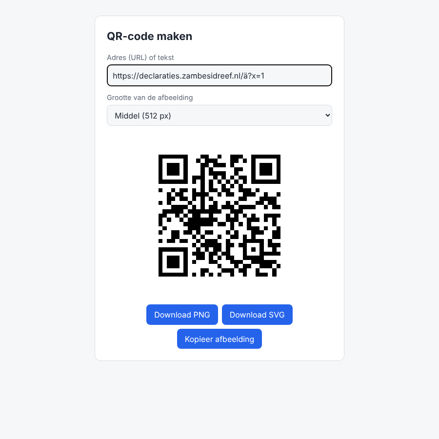

# QR-pagina (optioneel)

Een losse pagina waarop je van een adres (URL) of tekst een QR-code maakt, die je als PNG
of SVG downloadt. De code wordt helemaal in de browser gemaakt; er gaat niets naar de
server. De pagina staat achter een wachtwoord (de browser vraagt om gebruikersnaam en
wachtwoord) en draait op een eigen subdomein via dezelfde Caddy als de declaratietool.



De pagina zelf staat in [`extras/qr/`](../extras/qr/) en gebruikt de MIT-bibliotheek
[qrcode-generator](https://github.com/kazuhikoarase/qrcode-generator) van Kazuhiko Arase.

## Aanzetten

Nodig: een DNS A-record van het subdomein (bijv. `qr.example.org`) naar de server, en een
installatie met Caddy (de standaard `docker-compose.yml`) die is bijgewerkt naar een versie
met deze pagina (knop **Bijwerken** in het portaal).

```bash
cd /opt/declaratietool
docker compose exec caddy caddy hash-password   # typ het wachtwoord twee keer; kopieer de hash
cp sites/qr.caddy.example sites/qr.caddy
nano sites/qr.caddy                             # domein, gebruikersnaam en hash invullen
docker compose exec caddy caddy reload --config /etc/caddy/Caddyfile
```

Geeft `reload` een fout, dan blijft de oude configuratie gewoon draaien; de declaratietool
merkt er niets van. Verbeter `sites/qr.caddy` en probeer opnieuw.

Open daarna `https://qr.example.org`. Het eerste bezoek duurt een paar seconden, omdat
Caddy dan het certificaat ophaalt. De browser vraagt om gebruikersnaam en wachtwoord en
onthoudt die desgewenst.

## Wachtwoord wijzigen

Maak een nieuwe hash met `caddy hash-password`, zet die in `sites/qr.caddy` en herlaad
Caddy (laatste regel hierboven). Meer gebruikers kan ook: één regel per gebruiker.

## Tip

Je kunt een adres meegeven in de link: `https://qr.example.org/#https://example.org`
opent de pagina met de QR-code van `https://example.org` al klaar.
